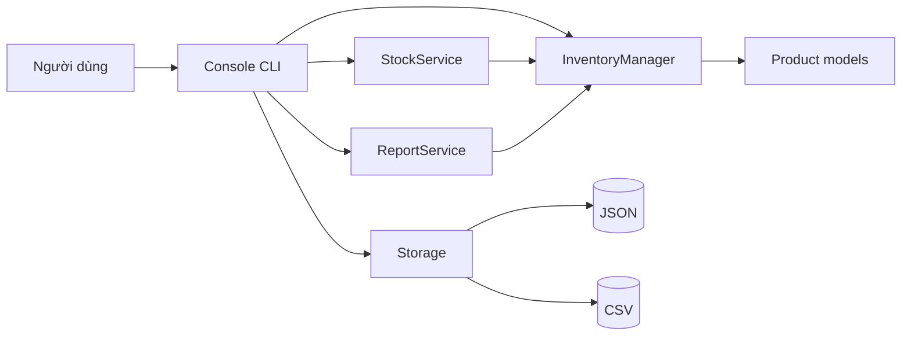
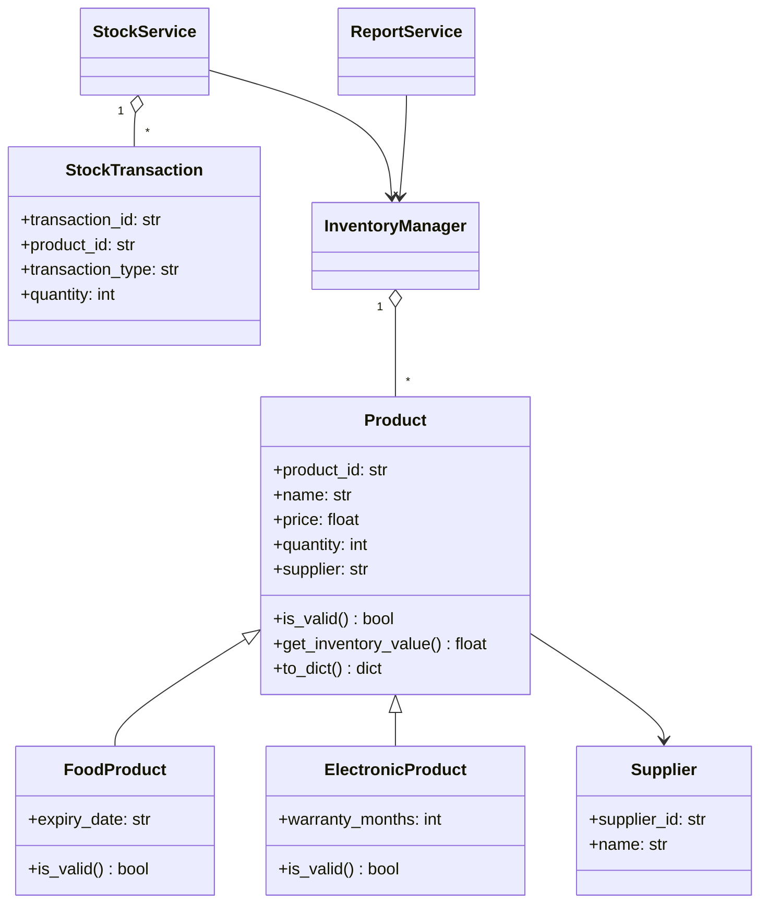

# Nội dung slide demo – Quản lý kho sản phẩm bằng Python OOP

Tài liệu khung để Minh dàn trang PowerPoint/Canva. Mỗi mục tương ứng một slide; dùng ảnh chụp thật từ CLI sau khi Tiến tích hợp để thay các ô gợi ý.

## 1. Trang bìa

**Product Inventory Management System**  
Quản lý kho sản phẩm bằng Python OOP · Nhóm 6 thành viên · 06/11/2026–25/11/2026

Ảnh minh họa: ảnh sản phẩm/kệ hàng đơn giản; tông xanh navy, xanh lá làm điểm nhấn.

## 2. Bài toán và mục tiêu

- Theo dõi danh mục, nhà cung cấp, nhập/xuất kho và tồn hiện tại.
- Tra cứu, sắp xếp, xem báo cáo giá trị kho, hạn dùng và bảo hành.
- Dùng OOP: đóng gói, kế thừa, đa hình; CLI Python và lưu trữ JSON/CSV.

## 3. Kiến trúc chương trình

## 4. UML lớp cốt lõi

## 5. Luồng demo

1. Thêm sản phẩm thường, thực phẩm và điện tử.
2. Nhập kho, xuất kho; thử xuất vượt tồn để minh họa kiểm tra nghiệp vụ.
3. Tìm sản phẩm, xem báo cáo kho và kiểm tra hạn dùng/bảo hành.
4. Lưu JSON, khởi động/nạp lại dữ liệu, xuất CSV mở bằng Excel.

Ảnh minh họa: `docs/screenshots/` – ảnh menu, danh sách sau nhập/xuất, báo cáo, CSV/Excel.

## 6. Kiểm thử và kết quả

- `unittest`: kiểm tra lưu/nạp JSON, khôi phục subtype, lỗi dữ liệu, CSV.
- Tích hợp: dùng checklist `docs/INTEGRATION_TEST_PLAN.md` sau khi các service được ghép.
- Chèn ảnh terminal có kết quả chạy và số test thực tế; không điền số liệu trước khi chạy.

## 7. Kết luận và hướng mở rộng

- Đã tách model, service, CLI và storage theo trách nhiệm.
- Mở rộng hợp lý tiếp theo: lưu lịch sử giao dịch/nhà cung cấp và nhập/xuất báo cáo theo bộ lọc.

**Ghi chú:** UML mô tả hợp đồng dự kiến hiện tại. Minh và Tiến cần đồng bộ sơ đồ với chữ ký cuối cùng sau khi ghép API.
