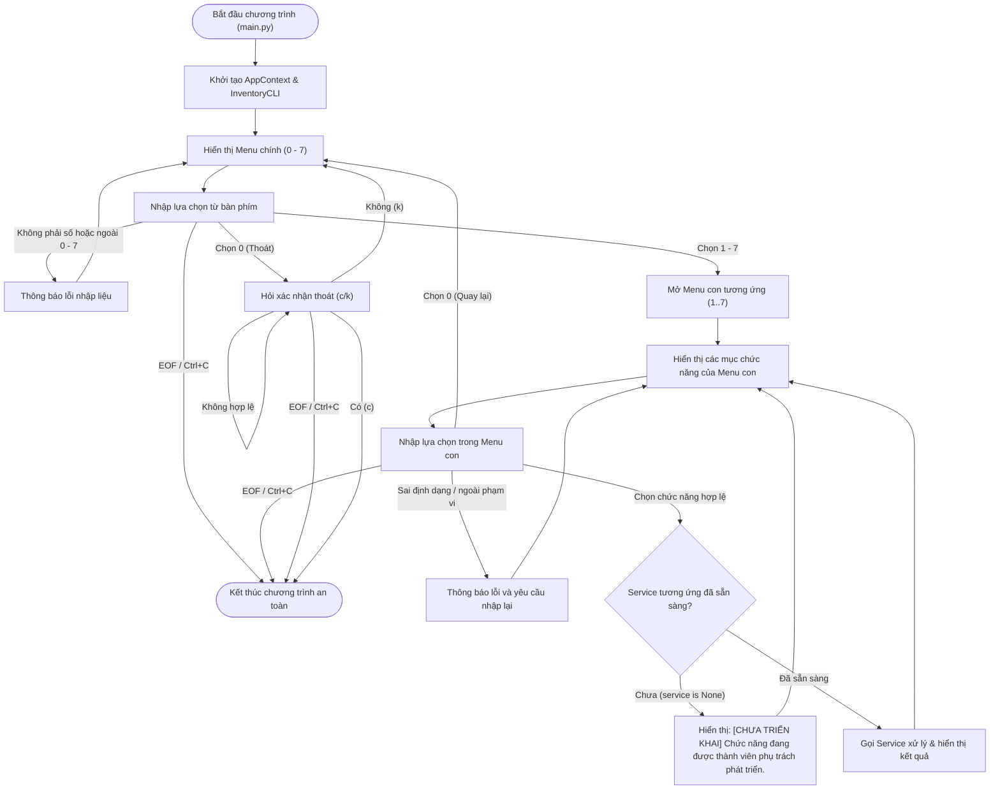
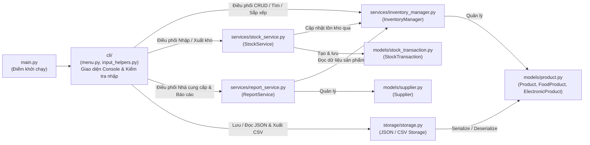

# Lưu đồ hoạt động Menu chính & Sơ đồ kiến trúc tổng quan

Tài liệu thiết kế cho phần giao diện Console và tích hợp hệ thống (Phụ trách: Thành viên 1 – Tiến, nhánh `feature/main-menu`).

---

## 1. Lưu đồ hoạt động của Menu chính

---

## 2. Sơ đồ kiến trúc tổng quan các tầng (`main.py → cli/ → services/ → models/` & `storage/`)

> **Lưu ý:** Sơ đồ dưới đây chỉ mô tả **kiến trúc phân tầng tổng quan** giữa các package, **không thay thế UML Class Diagram đầy đủ** (thuộc tính, phương thức, quan hệ kế thừa/kết hợp chi tiết của toàn bộ hệ thống sẽ được tổng hợp riêng trong `docs/uml/`).

