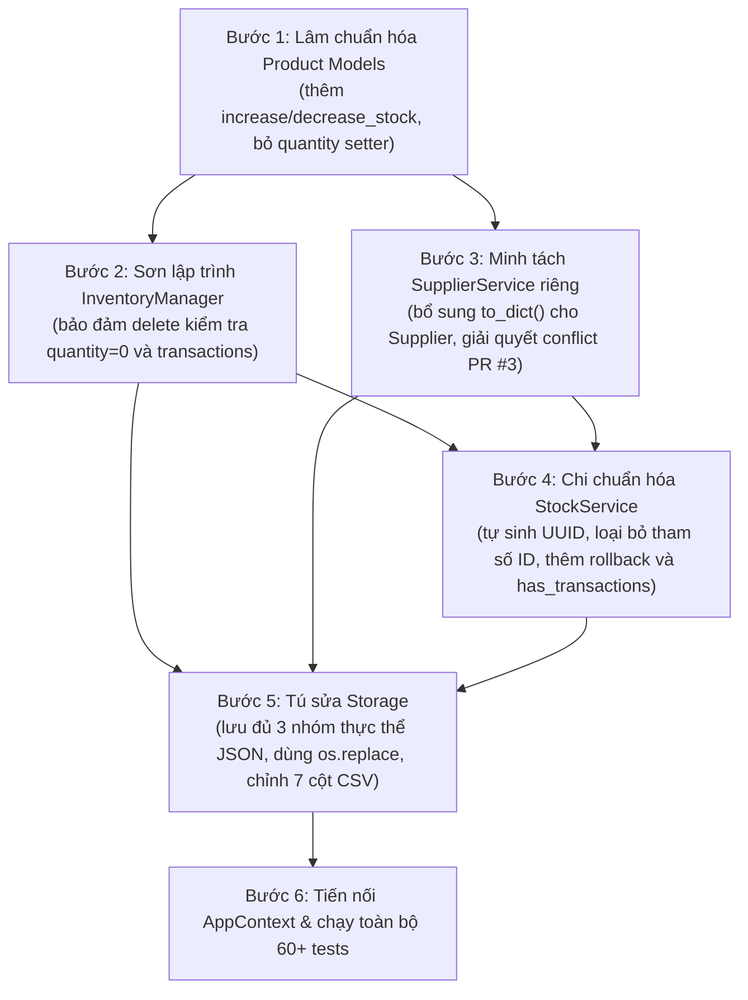

# BÁO CÁO KIỂM TOÁN TIẾN ĐỘ VÀ CHẤT LƯỢNG CODE 6 THÀNH VIÊN
**Dự án:** Product Inventory Management System  
**Ngày thực hiện kiểm toán:** 19/11/2026 (Thời gian local: 21:26:00+07:00)  
**Người thực hiện:** Senior Technical Team Leader / Software Architect (Tiến)  
**Tiêu chuẩn đối chiếu:** Design Baseline v1.0 (40 Quyết định phê duyệt – API Contract v1.0 & UML Design v1.0)  
**Hạn hoàn thành toàn dự án:** 25/11/2026 (Còn 6 ngày)  
**Chế độ kiểm toán:** AUDIT ONLY – READ ONLY (Không can thiệp sửa đổi code hoặc thay đổi lịch sử Git)

---

## 1. TỔNG QUAN DỰ ÁN (EXECUTIVE SUMMARY)

### 1.1. Tình trạng tiến độ tổng thể
Sau khi đối chiếu toàn bộ 6 nhánh remote (`origin/feature/*`) và nhánh `origin/main` trên GitHub repository:
- **Tiến độ tích hợp hệ thống thực tế:** **~55%** (Có sự phân hóa rất lớn giữa các thành viên).
- **Phân loại trạng thái 6 thành viên:**
  - **COMPLETE (Đạt 100%):** 0 thành viên.
  - **MOSTLY COMPLETE (Hoàn thành phần lớn, còn lỗi tích hợp):** 2 thành viên (Tiến 90% - bị chặn bởi phụ thuộc; Minh 70%).
  - **PARTIAL (Đang dở dang, thiếu tính năng cốt lõi):** 3 thành viên (Lâm 68%, Tú 58%, Chi 48%).
  - **NOT STARTED (Chưa có code nghiệp vụ được giao):** 1 thành viên (**Sơn 0%** – Nghẽn cổ chai nghiêm trọng nhất dự án).

### 1.2. Ba rủi ro sống còn (Critical Risks) đe dọa hạn nộp 25/11/2026
1. **RỦI RO P0 (Nghẽn cổ chai trung tâm):** Thành viên **Sơn** (`feature/product-management`) **chưa viết bất kỳ dòng code nào** cho `services/inventory_manager.py`. Nhánh của Sơn hiện tại chỉ chứa commit bị push nhầm của Lâm (`models/product.py`). Do `InventoryManager` là hạt nhân dữ liệu điều phối toàn bộ kho mà `StockService`, `ReportService` và `InventoryCLI` đều phụ thuộc vào, việc thiếu `InventoryManager` khiến toàn bộ hệ thống bị nghẽn tích hợp.
2. **RỦI RO P1 (Xung đột nhánh do Merge sớm ngoài phạm vi):** Thành viên **Tú** (`feature/storage-testing`) đã mở PR #4 và đã được merge vào `origin/main`. Tuy nhiên, PR #4 đã can thiệp sửa đổi và tạo các bản mock/stub dở dang trên file của **tất cả các thành viên khác** (`cli/menu.py`, `models/product.py`, `services/inventory_manager.py`, `services/report_service.py`, `services/stock_service.py`). Hậu quả trực tiếp là **PR #3 của Minh bị xung đột hòa trộn (MERGE CONFLICT - dirty state)** và toàn bộ các nhánh còn lại của Lâm, Chi khi merge vào `main` đều sẽ bị xung đột code!
3. **RỦI RO P1 (Lệch chuẩn API Contract & Sai kiến trúc v1.0):**
   - **Minh:** Đưa toàn bộ CRUD nhà cung cấp vào `ReportService`, **chưa tạo module `services/supplier_service.py`** như Q16 quy định; `Supplier` thiếu `to_dict()`.
   - **Tú:** Module `storage/storage.py` **chỉ lưu và đọc danh sách sản phẩm**, bỏ rơi hoàn toàn `suppliers` và `transactions` (vi phạm Q05, Q33); không dùng cơ chế ghi file an toàn nguyên tử `os.replace` (vi phạm Q34).
   - **Chi:** Chữ ký `import_stock()` và `export_stock()` bắt buộc người gọi phải truyền `transaction_id`, không tự sinh UUID (vi phạm Q25); chưa tích hợp kiểm tra `FoodProduct.is_expired()` (vi phạm Q10); không có rollback (vi phạm Q27); chấp nhận số lượng kiểu `bool` (`True`).
   - **Lâm:** `Product` thiếu `increase_stock()` và `decrease_stock()`; vẫn để `@quantity.setter` công khai (vi phạm Q08); `supplier` chưa đổi tên thành `supplier_id`.

---

## 2. KIỂM TOÁN CÁC NHÁNH GIT TRÊN GITHUB (GIT BRANCH AUDIT)

| Thành viên | Tên nhánh GitHub | Commit HEAD | Thời gian commit | Tác giả commit | Files thay đổi so với base `dcaf8a1` | Trạng thái Pull Request | Trạng thái so với `origin/main` |
| :--- | :--- | :---: | :---: | :--- | :--- | :---: | :---: |
| **Tiến** | `feature/main-menu` | `dcaf8a1` | 12/11/2026 | vuongtien1611 | Menu CLI, Helpers, Docs, UML (Đang ở local) | PR #1, PR #2 (Đã MERGED) | Đang ở commit base trước PR #4 |
| **Lâm** | `feature/product-models` | `53e2707` | 17/11/2026 21:35 | bachgialam123 | `models/__init__.py`, `models/product.py` | Chưa tạo PR | Xung đột nội dung `models/product.py` |
| **Sơn** | `feature/product-management`| `a39d1e4` | 16/11/2026 23:45 | bachgialam123 *(Lâm commit)* | `models/__init__.py`, `models/product.py` *(Không có service)* | Chưa tạo PR | Xung đột nội dung `models/product.py` |
| **Chi** | `feature/stock-transactions` | `eaedbdc` | 16/11/2026 20:02 | linhchinguyen716-byte | `models/stock_transaction.py`, `services/stock_service.py` | Chưa tạo PR | Xung đột nội dung `services/stock_service.py` |
| **Minh** | `feature/supplier-reports` | `640bfcd` | 19/11/2026 17:57 | dasli-vu | `models/supplier.py`, `services/report_service.py` | **PR #3 (OPEN)** | **Bị CONFLICT (dirty state)** với `origin/main` |
| **Tú** | `feature/storage-testing` | `5dbf1b5` | 19/11/2026 19:06 | dominhtu582 | 17 files (`storage/`, `tests/`, `cli/`, `models/`, `services/`) | **PR #4 (ĐÃ MERGE)** | Đã gộp vào `origin/main` (commit `2d62228`) |

---

## 3. ĐÁNH GIÁ CHI TIẾT TỪNG THÀNH VIÊN (DETAILED MEMBER REVIEW)

### 3.1. Thành viên 2: LÂM (`feature/product-models` – Commit `53e2707`)
- **Phạm vi phân công:** `models/product.py` (`Product`, `FoodProduct`, `ElectronicProduct`).
- **Nội dung đã làm được:**
  - Đã xây dựng đầy đủ cây kế thừa: `FoodProduct(Product)` và `ElectronicProduct(Product)`.
  - Kiểm tra đầu vào qua `@property`: không rỗng `product_id`, `name`; `price >= 0` và số hữu hạn; `quantity >= 0`.
  - Có các phương thức `is_valid()`, `to_dict()`, `get_inventory_value()`, `__str__()`.
  - `FoodProduct` kiểm tra định dạng ngày `YYYY-MM-DD` qua `datetime.strptime`.
  - `ElectronicProduct` kiểm tra `warranty_months >= 0`.
  - Chạy `unittest discover -s tests -v`: 2 bootstrap tests PASS.
- **Những điểm sai và thiếu so với API Contract v1.0:**
  1. **Thiếu phương thức điều phối tồn kho:** Không có `increase_stock(amount: int)` và `decrease_stock(amount: int)`.
  2. **Vi phạm tính đóng gói của tồn kho (Q08):** Vẫn để `@quantity.setter` công khai, cho phép bất kỳ module nào sửa `product.quantity = 999` mà không qua `StockService`.
  3. **Lệch tên thuộc tính:** Đặt tên thuộc tính là `self.supplier` / `_supplier` thay vì `supplier_id` / `_supplier_id`.
  4. **Thiếu phương thức nghiệp vụ thực phẩm:** `FoodProduct.days_until_expiry(current_date=None)` chưa được viết.
  5. **Chữ ký `is_expired()` không nhận tham số:** Chỉ dùng `date.today()`, không nhận `current_date: date | None = None`.
  6. **Lệch thứ tự tham số `__init__`:** Trong `FoodProduct`, `expiry_date` đứng trước `supplier`; trong `ElectronicProduct`, `warranty_months` đứng trước `supplier`. Điều này gây lỗi `ValueError` khi khởi tạo theo hợp đồng chung `(product_id, name, price, quantity=0, supplier_id="", expiry_date="")`.
- **Tiến độ:** **68% (PARTIAL)**.

---

### 3.2. Thành viên 3: SƠN (`feature/product-management` – Commit `a39d1e4`)
- **Phạm vi phân công:** `services/inventory_manager.py` (`InventoryManager`).
- **Nội dung đã làm được:**
  - Nhánh đã tồn tại trên remote GitHub.
- **Những điểm sai và thiếu:**
  1. **CHƯA VIẾT CODE:** Commit duy nhất trên nhánh là `a39d1e4` mang tên tác giả của Lâm (`bachgialam123`), chỉ sửa `models/product.py`.
  2. File `services/inventory_manager.py` trên nhánh của Sơn chỉ có phần docstring và TODO nguyên thủy, **0 dòng code thực tế**.
  3. Tất cả các phương thức cốt lõi (`add_product`, `update_product`, `delete_product`, `get_product_by_id`, `get_all_products`, `search_product`, `sort_products`) đều chưa được lập trình.
- **Tiến độ:** **0% (NOT STARTED)** – Đây là điểm nghẽn nghiêm trọng nhất của cả dự án hiện nay.

---

### 3.3. Thành viên 4: CHI (`feature/stock-transactions` – Commit `eaedbdc`)
- **Phạm vi phân công:** `models/stock_transaction.py`, `services/stock_service.py`.
- **Nội dung đã làm được:**
  - Lớp `StockTransaction` lưu trữ `transaction_id`, `product_id`, `transaction_type`, `quantity`, `timestamp`, `note`. Có `to_dict()` và `__str__()`.
  - Lớp `StockService` triển khai `import_stock()`, `export_stock()`, `get_transaction_history()`.
  - Phân biệt loại giao dịch `IMPORT` và `EXPORT`.
- **Những điểm sai và thiếu so với API Contract v1.0:**
  1. **Lệch chữ ký nghiêm trọng:** `import_stock()` và `export_stock()` yêu cầu caller phải truyền vào `transaction_id: str`. Theo chuẩn Q25, ID giao dịch phải do `StockService` tự sinh bằng `str(uuid.uuid4())`.
  2. **Không kết nối đúng với `InventoryManager` và `Product`:** Tự viết logic tạm `hasattr(im, 'get_stock')` hoặc lưu vào dict riêng `_local_stock`, không gọi `Product.increase_stock()` / `decrease_stock()`.
  3. **Lỗ hổng kiểu dữ liệu (Q23):** Dùng `if not isinstance(quantity, int) or quantity <= 0:`. Vì trong Python `isinstance(True, int) == True`, nên khi truyền `True`, hệ thống chấp nhận số lượng là `True` (<class 'bool'>) và ghi nhận giao dịch thành công!
  4. **Thiếu kiểm tra thực phẩm hết hạn (Q10):** Nhập kho không kiểm tra sản phẩm có phải là `FoodProduct` hết hạn hay không.
  5. **Thiếu cơ chế Rollback nguyên tử (Q27):** Không có khối `try...except` hoàn tác số lượng khi lưu lịch sử thất bại.
  6. **Thiếu phương thức bắt buộc:** `has_product_transactions(product_id: str) -> bool` hoàn toàn không có (khiến nghiệp vụ xóa sản phẩm của Sơn bị thiếu dependency).
  7. **Vi phạm đóng gói:** `StockTransaction` không dùng `@property` chỉ đọc, các thuộc tính công khai có thể bị ghi đè tùy tiện từ bên ngoài.
  8. **Vi phạm kiến trúc:** Chèn lệnh `print()` trực tiếp trong tầng service.
- **Tiến độ:** **48% (PARTIAL)**.

---

### 3.4. Thành viên 5: MINH (`feature/supplier-reports` – Commit `640bfcd`, PR #3)
- **Phạm vi phân công:** `models/supplier.py`, `services/supplier_service.py` (Q16), `services/report_service.py`.
- **Nội dung đã làm được:**
  - Lớp `Supplier` được đóng gói rất tốt: `@property` đầy đủ cho `supplier_id`, `name`, `phone`, `address`, `email`; regex kiểm tra số điện thoại (tối thiểu 7 chữ số) và định dạng email; `is_valid()`, `__str__()`, `__repr__()`, `__eq__()`.
  - Lớp `ReportService` xây dựng đầy đủ các thuật toán báo cáo: `get_total_inventory_value()`, `get_low_stock_products(threshold=5)`, `get_expiring_food_products(days=7)`, `check_food_expiry_status(product_id=None)`, `get_warranty_summary(product_id=None)`.
  - Xử lý linh hoạt việc nhận diện loại sản phẩm qua duck-typing khi các module khác chưa tích hợp.
- **Những điểm sai và thiếu so với API Contract v1.0:**
  1. **Sai cấu trúc kiến trúc (Q16):** Toàn bộ CRUD nhà cung cấp (`add_supplier`, `update_supplier`, `delete_supplier`, `get_all_suppliers`, `get_supplier_by_id`) bị nhét vào trong `ReportService`. **Không có file `services/supplier_service.py`**.
  2. **Thiếu phương thức tuần tự hóa:** `Supplier` chưa có phương thức `to_dict()`.
  3. **Lệch kiểu trả về giá trị tồn kho (Q32):** `get_total_inventory_value()` trả về `float` đơn thuần, chưa trả về `dict` có cảnh báo giá trị thực phẩm hết hạn theo thiết kế v1.0.
  4. **PR #3 bị xung đột hòa trộn:** Do Tú đã merge PR #4 vào `main` trước, PR #3 hiện tại bị dán nhãn `dirty / not mergeable` trên GitHub vì xung đột file `services/report_service.py`.
- **Tiến độ:** **70% (MOSTLY COMPLETE)**.

---

### 3.5. Thành viên 6: TÚ (`feature/storage-testing` – Commit `5dbf1b5`, PR #4 merged)
- **Phạm vi phân công:** `storage/storage.py`, `tests/` (`unittest`).
- **Nội dung đã làm được:**
  - Viết module `storage/storage.py` đọc/ghi JSON và xuất CSV.
  - Viết bộ 60 unit tests rất phong phú trong thư mục `tests/` (`test_inventory.py`, `test_stock.py`, `test_reports.py`, `test_product.py`, `test_cli_integration.py`).
  - Viết file `run_integration_tests.py` chạy kiểm thử tích hợp (6 kịch bản PASS).
  - Soạn thảo tài liệu thuyết trình `create_demo_deck.py` và `docs/DEMO_SLIDES.md`.
  - Tạo PR #4 và đã được merge vào `origin/main`.
- **Những sai phạm và lỗi nghiêm trọng so với API Contract v1.0:**
  1. **Can thiệp ngoài phạm vi phân công (Scope Creep):** Tự ý sửa đổi file của cả 5 thành viên khác (`cli/menu.py`, `models/product.py`, `services/inventory_manager.py`, `services/report_service.py`, `services/stock_service.py`) để làm các stub code cho test của mình chạy. Điều này trực tiếp gây ra xung đột Git cho tất cả các nhánh còn lại của nhóm!
  2. **Vi phạm lưu trữ toàn diện (Q05, Q33):** Hàm `save_to_json(products, file_path)` và `load_from_json(file_path)` **chỉ lưu và đọc duy nhất danh sách sản phẩm `products`**. Hoàn toàn bỏ quên `suppliers` và `transactions`!
  3. **Lệch chữ ký hàm lưu trữ:** API Contract quy định `save_to_json(data: dict, file_path) -> bool` với `data = {"products": [...], "suppliers": [...], "transactions": [...]}`. Code của Tú lại nhận tham số đầu vào là `products: Iterable[Any]`.
  4. **Không dùng cơ chế ghi file nguyên tử (Q34):** Ghi đè trực tiếp file bằng `with open("w")`, không dùng file tạm `.tmp` và `os.replace`.
  5. **Lệch cấu trúc CSV (Q35):** Xuất 8 cột thừa/thiếu, thiếu cột `inventory_value`.
  6. **Tạo ra lỗ hổng bảo vệ tồn kho (Q08):** Trong file `services/inventory_manager.py` mà Tú tự viết trên `main`, hàm `update_product()` lại cho phép sửa trực tiếp `quantity` (`allowed = {"name", "price", "quantity", "supplier"}`).
- **Tiến độ:** **58% (PARTIAL)**.

---

### 3.6. Thành viên 1: TIẾN (`feature/main-menu` – Commit `dcaf8a1`)
- **Phạm vi phân công:** Trưởng nhóm, kiến trúc hệ thống, Console CLI (`main.py`, `cli/`), tích hợp toàn hệ thống.
- **Nội dung đã làm được:**
  - Hoàn thành bộ khung CLI điều hướng với Menu chính và 7 Menu con theo đúng chuẩn.
  - Triển khai cơ chế phòng thủ bắt lỗi tiếng Việt (`_require_service`, `read_menu_choice`, `read_sort_order`).
  - Đã tích hợp luồng thoát an toàn 3 lựa chọn (Thử lưu lại, Hủy thoát, Thoát không lưu) theo Sequence 5.
  - Chuẩn hóa toàn bộ bộ hồ sơ kiến trúc: `API_CONTRACT.md`, `TASK_ASSIGNMENT.md`, `UML_DESIGN.md` (Class, Use Case 18 UCs, Activity, Sequence Diagrams) đạt 100% render vector SVG.
- **Tình trạng tích hợp:**
  - **BLOCKED BY DEPENDENCY:** Phần tích hợp gọi service thật vào `AppContext` chưa thể nối dây vì:
    - Sơn chưa code `InventoryManager`.
    - Minh chưa tách `SupplierService`.
    - Chi lệch chữ ký `StockService`.
    - `main` đang bị nhiễm stub code của Tú từ PR #4.
- **Tiến độ:** **90% (MOSTLY COMPLETE – BLOCKED FOR FINAL INTEGRATION)**.

---

## 4. BẢNG THEO DÕI LỖI VÀ RỦI RO TÍCH HỢP (BUG & INTEGRATION RISK REGISTER)

| Mã BUG | Mức độ | Nhánh liên quan | Tệp & Dòng code | Mô tả lỗi & Nguyên nhân kỹ thuật | Cách tái hiện | Kết quả mong đợi | Kết quả thực tế | Thành viên phụ trách |
| :---: | :---: | :--- | :--- | :--- | :--- | :--- | :--- | :---: |
| **BUG-01** | **P0** | `feature/product-management` | `services/inventory_manager.py:L1-35` | **Trống toàn bộ module nghiệp vụ:** Sơn chưa viết bất kỳ phương thức nào của `InventoryManager`. | `from services.inventory_manager import InventoryManager; im = InventoryManager()` | Khởi tạo thành công `InventoryManager` với các phương thức CRUD. | `ImportError: cannot import name 'InventoryManager'` | **Sơn** |
| **BUG-02** | **P1** | `feature/supplier-reports` | `services/report_service.py:L70-200` | **Sai kiến trúc module (Q16):** Toàn bộ CRUD nhà cung cấp bị gộp vào `ReportService`. Thiếu file `services/supplier_service.py`. | Kiểm tra file `services/supplier_service.py` | Tồn tại lớp `SupplierService` độc lập. | Không tìm thấy file `services/supplier_service.py`. | **Minh** |
| **BUG-03** | **P1** | `feature/supplier-reports` | Pull Request #3 trên GitHub | **Merge conflict do PR #4:** PR #3 của Minh xung đột với file `services/report_service.py` trên `main`. | Xem PR #3 trên GitHub (`gh api .../pulls/3`) | `mergeable: true` | `mergeable: false, mergeable_state: dirty` | **Minh / Tú** |
| **BUG-04** | **P1** | `feature/storage-testing` & `main` | `storage/storage.py:L60-90` | **Lưu trữ thiếu thực thể (Q05, Q33):** `save_to_json` chỉ lưu list `products`, bỏ rơi hoàn toàn `suppliers` và `transactions`. Không ghi file tạm (Q34). | `Storage.save_to_json({"products": [], "suppliers": [], "transactions": []})` | Lưu đủ 3 khóa vào JSON an toàn qua file tạm và `os.replace`. | Báo lỗi hoặc chỉ lưu mảng `products`, file bị ghi đè trực tiếp. | **Tú** |
| **BUG-05** | **P1** | `feature/stock-transactions` | `services/stock_service.py:L48-80` | **Lệch chữ ký API Contract (Q25):** `import_stock()` và `export_stock()` bắt buộc truyền `transaction_id`. Thiếu hàm `has_product_transactions()`. | `svc.import_stock('P01', 10)` | Tự sinh UUID và trả về `StockTransaction`. | `TypeError: missing 1 required positional argument: 'quantity'` | **Chi** |
| **BUG-06** | **P2** | `feature/stock-transactions` | `services/stock_service.py:L55` | **Lỗ hổng kiểu boolean (Q23):** Nhận `True` là số lượng hợp lệ vì `isinstance(True, int) == True`. | `svc.import_stock('TX01', 'P01', True)` | Ném `ValueError` từ chối kiểu boolean. | Nhập kho thành công số lượng `True` (tồn kho tăng `True`). | **Chi** |
| **BUG-07** | **P2** | `feature/product-models` | `models/product.py:L78-95` | **Vi phạm đóng gói tồn kho (Q08):** Có `@quantity.setter` công khai. Thiếu `increase_stock()` và `decrease_stock()`. | `p.quantity = -10` hoặc `p.increase_stock(5)` | Không có setter `quantity`; có `increase_stock` và `decrease_stock`. | Sửa được `quantity` trực tiếp; gọi `increase_stock` báo `AttributeError`. | **Lâm** |
| **BUG-08** | **P2** | `feature/supplier-reports` | `models/supplier.py` | **Thiếu phương thức tuần tự hóa:** Lớp `Supplier` không có phương thức `to_dict()`. | `supplier.to_dict()` | Trả về dict dữ liệu của nhà cung cấp. | `AttributeError: 'Supplier' object has no attribute 'to_dict'` | **Minh** |

---

## 5. BẢNG TỔNG HỢP TIẾN ĐỘ THÀNH VIÊN (COMPLETION MATRIX)

*Quy tắc tính điểm chuẩn:*
- **Chức năng được giao (50%):** Mức độ hoàn thành các phương thức/chức năng theo phân công.
- **Tuân thủ API & UML (20%):** Khớp chữ ký, kiểu dữ liệu, ngoại lệ và nguyên tắc Q01–Q40.
- **Kiểm thử thực tế (20%):** Tỷ lệ unit test thực tế kiểm chứng thành công code của chính mình.
- **Cấu trúc OOP & Tích hợp (10%):** Đóng gói, kế thừa, không phá vỡ nhánh khác.

| Thành viên | Nhánh công việc | Chức năng (50%) | API & UML (20%) | Test thực tế (20%) | OOP & Tích hợp (10%) | Tổng tiến độ | Đánh giá trạng thái |
| :--- | :--- | :---: | :---: | :---: | :---: | :---: | :--- |
| **Tiến** | `feature/main-menu` | 45% | 20% | 15% | 10% | **90%** | **MOSTLY COMPLETE (BLOCKED BY DEP)** |
| **Lâm** | `feature/product-models` | 35% | 10% | 15% | 8% | **68%** | **PARTIAL** |
| **Sơn** | `feature/product-management`| 0% | 0% | 0% | 0% | **0%** | **NOT STARTED (CRITICAL BLOCKER)** |
| **Chi** | `feature/stock-transactions`| 25% | 8% | 10% | 5% | **48%** | **PARTIAL** |
| **Minh** | `feature/supplier-reports` | 35% | 12% | 15% | 8% | **70%** | **MOSTLY COMPLETE** |
| **Tú** | `feature/storage-testing` | 25% | 10% | 18% | 5% | **58%** | **PARTIAL (SCOPE CREEP)** |

---

## 6. KHẢ NĂNG TÍCH HỢP VÀ KẾ HOẠCH HÒA TRỘN (INTEGRATION READINESS)

### 6.1. Đánh giá hiện trạng nhánh `origin/main`
Nhánh `origin/main` hiện đang ở commit `2d62228` (sau khi merge PR #4 của Tú). `origin/main` hiện đang chứa một phiên bản chắp vá:
- `models/product.py` của Tú (thiếu phương thức của Lâm).
- `services/inventory_manager.py` stub của Tú (cho phép sửa `quantity`, thiếu kiểm tra giao dịch).
- `services/stock_service.py` stub của Tú (không có logic của Chi).
- `services/report_service.py` stub của Tú (chưa có logic của Minh).
- `models/supplier.py` và `models/stock_transaction.py` vẫn là file khung rỗng!

### 6.2. Thứ tự giải quyết xung đột và tích hợp bắt buộc
Không thể merge tự do các nhánh lúc này. Phải đi theo đúng quy trình 6 bước:



---

## 7. KẾ HOẠCH HÀNH ĐỘNG KHẨN CẤP TRƯỚC 25/11/2026 (ACTION PLAN)

| Thời hạn | Thành viên | Nhiệm vụ kỹ thuật cụ thể cần hoàn thành ngay | Mức ưu tiên |
| :---: | :--- | :--- | :---: |
| **20/11** | **Sơn** | **Viết ngay `services/inventory_manager.py`:** Triển khai đầy đủ CRUD, chống trùng mã, cấm sửa `quantity`, `delete_product` kiểm tra `quantity == 0` và `stock_service.has_product_transactions()`, `get_product_by_id` ném `KeyError`. | **P0 (Khẩn cấp)** |
| **20/11** | **Lâm** | **Sửa `models/product.py`:** Thêm `increase_stock()`, `decrease_stock()`; xóa `@quantity.setter`; đổi `supplier` thành `supplier_id`; thêm `days_until_expiry()`. | **P1 (Cao)** |
| **21/11** | **Minh** | **Tách `SupplierService`:** Tạo file `services/supplier_service.py` chuyển các hàm CRUD sang; giữ `ReportService` thuần túy thống kê; thêm `to_dict()` cho `Supplier`; rebase giải quyết conflict với `main`. | **P1 (Cao)** |
| **21/11** | **Chi** | **Sửa `StockService` & `StockTransaction`:** Sửa chữ ký `import_stock(product_id, quantity, note="")` tự sinh UUID; thêm `has_product_transactions()`; thêm atomic rollback; chặn `bool`; đóng gói `_quantity`. | **P1 (Cao)** |
| **22/11** | **Tú** | **Sửa `storage/storage.py`:** Sửa `save_to_json(data)` và `load_from_json()` lưu/đọc đủ cả `products`, `suppliers`, `transactions`; ghi file tạm `os.replace`; sửa CSV đủ 7 cột. Dọn dẹp stub code thừa. | **P1 (Cao)** |
| **23/11** | **Tiến** | **Tích hợp toàn diện:** Nối các service thật vào `AppContext` trong `cli/menu.py`; chạy toàn bộ test suite; kiểm tra luồng Console thực tế. | **P1 (Cao)** |
| **24/11** | **Cả nhóm** | **Nghiệm thu toàn hệ thống:** Chụp màn hình CLI, kiểm thử các ca biên, đóng gói báo cáo bài tập lớn Word/PDF. | **P2 (Chuẩn bị nộp)** |
| **25/11** | **Tiến** | **Nộp bài tập lớn chính thức.** | **DEADLINE** |

---

## 8. PHỤ LỤC BẰNG CHỨNG KIỂM TOÁN (EVIDENCE APPENDIX)

### 8.1. Các lệnh Git kiểm tra thực tế
```bash
git fetch origin --prune
git branch -a
git log --all --oneline --decorate -25
git merge-tree origin/main origin/feature/supplier-reports
gh api repos/vuongtien1611/python-inventory-management-system/pulls/3
```

### 8.2. Bằng chứng Commit Hashes
- Base commit: `dcaf8a1` (PR #2 merged)
- `origin/feature/product-models`: `53e270710d1293c81c1cc368ccfa296cf2997aec`
- `origin/feature/product-management`: `a39d1e43cf912709e36f3fcece53bf610507fbf2`
- `origin/feature/stock-transactions`: `eaedbdc07cd300205bdcacdf009094ee04f10d4e`
- `origin/feature/supplier-reports`: `640bfcdc2c24405b40f057b3c98ccbce201072c4`
- `origin/feature/storage-testing`: `5dbf1b5236072c1ecf2d0f3df19196e59f58e262`
- `origin/main` (HEAD): `2d62228d44ee48d1c92582877a5ddf1d19169fa1`

### 8.3. Bằng chứng lỗi code qua thực thi mẫu
- **Lỗ hổng Boolean trên nhánh Chi (`eaedbdc`):**
  ```python
  svc = StockService()
  tx = svc.import_stock('TX01', 'P01', True)
  # Output thực tế: [SUCCESS] Nhập kho thành công: +True cho sản phẩm P01. Tồn kho mới: 1
  # tx.quantity là True (<class 'bool'>) -> Vi phạm Q23!
  ```
- **Lỗi thiếu phương thức trên nhánh Lâm (`53e2707`):**
  ```python
  hasattr(Product('P1', 'A', 10, 5), 'increase_stock')  # False -> Vi phạm API Contract v1.0!
  hasattr(Product('P1', 'A', 10, 5), 'supplier_id')     # False (chỉ có supplier)
  ```
- **Lỗi thiếu phương thức trên nhánh Minh (`640bfcd`):**
  ```python
  hasattr(Supplier('S1', 'A', '0912345678', 'HN'), 'to_dict')  # False -> Lỗi serialize JSON!
  os.path.exists('services/supplier_service.py')               # False -> Vi phạm Q16!
  ```
- **Bằng chứng Merge Conflict PR #3 của Minh:**
  ```text
  XUNG ĐỘT (nội dung): Xung đột hòa trộn trong services/report_service.py
  GitHub API: {"mergeable": false, "mergeable_state": "dirty", "number": 3}
  ```

---
*Báo cáo được lưu trữ chính thức tại [docs/reviews/TEAM_BRANCH_CODE_AUDIT_2026-11-19.md](file:///home/vuongductien/Tài%20liệu/quản%20lý%20kho%20hàng%20python/docs/reviews/TEAM_BRANCH_CODE_AUDIT_2026-11-19.md) để làm căn cứ họp kỹ thuật và giao việc khẩn cấp cho cả 6 thành viên.*

