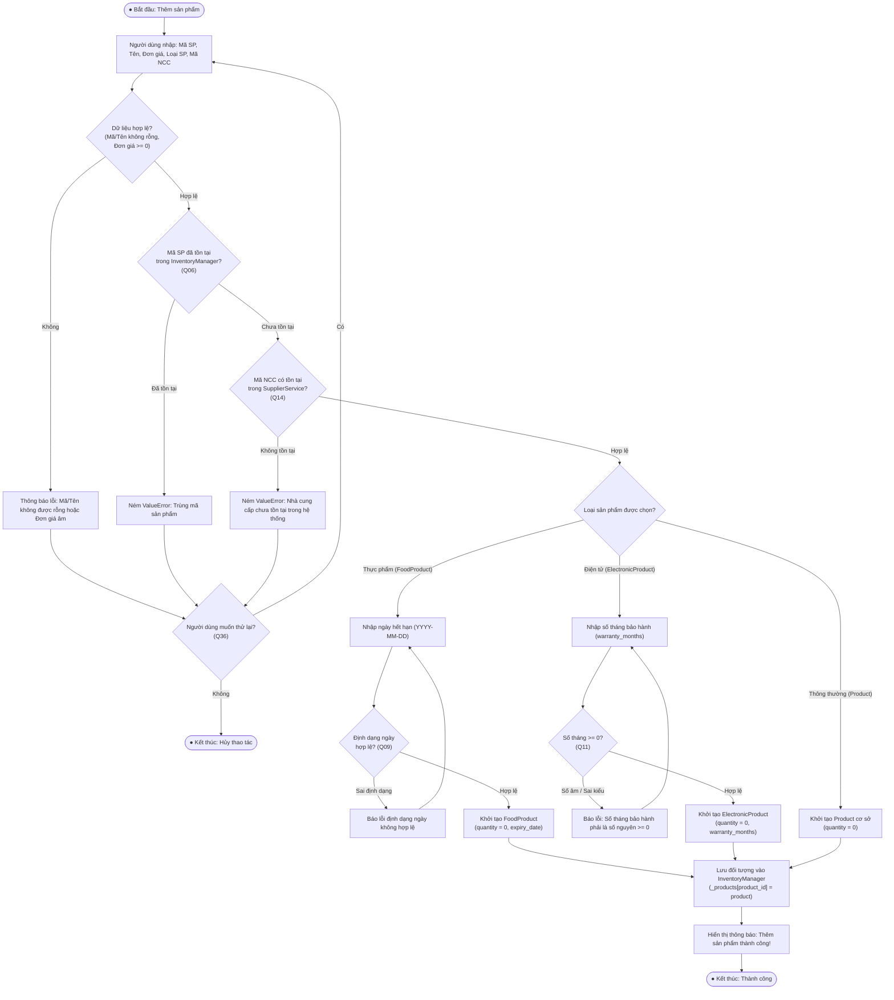
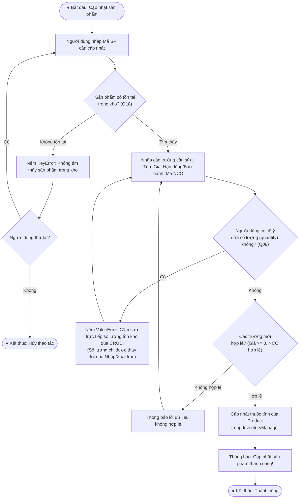
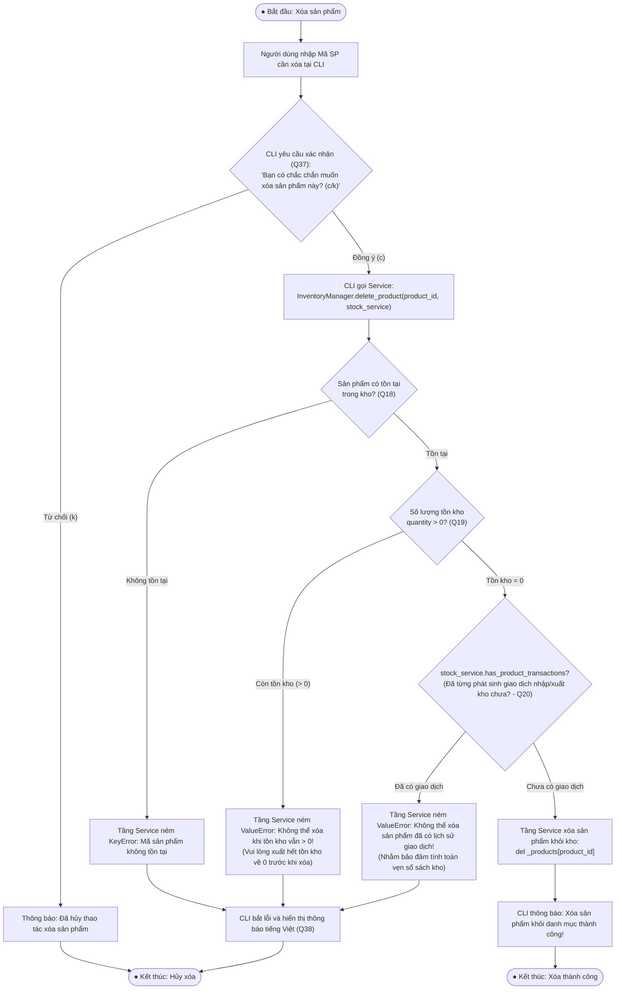
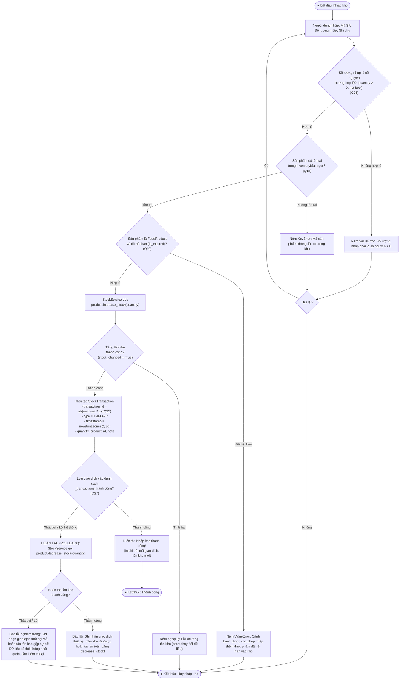
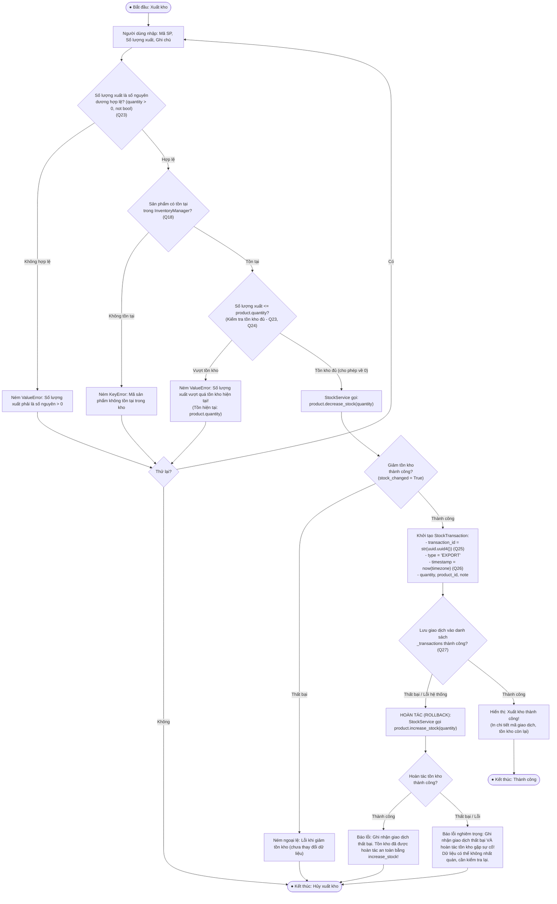

# Thiết Kế UML Lưu Đồ Hoạt Động (Activity Diagram) – v1.0

- **Hệ thống:** Product Inventory Management System
- **Chuẩn thiết kế:** Approved Design v1.0 (Khớp 40 quyết định thiết kế chính thức)
- **Tài liệu đối chiếu:** [API_CONTRACT.md](../API_CONTRACT.md), [TASK_ASSIGNMENT.md](../TASK_ASSIGNMENT.md)

---

## 1. LƯU ĐỒ HOẠT ĐỘNG: THÊM SẢN PHẨM MỚI (ADD PRODUCT)

Quy trình thể hiện việc kiểm tra mã sản phẩm không trùng (Q06), đơn giá không âm (Q07), kiểm tra sự tồn tại của nhà cung cấp (Q14), phân nhánh cho sản phẩm đặc thù và khởi tạo tồn kho bằng 0 (Q08):

---

## 2. LƯU ĐỒ HOẠT ĐỘNG: CẬP NHẬT VÀ XÓA SẢN PHẨM (UPDATE & DELETE PRODUCT)

### 2.1. Hoạt động Cập nhật Sản phẩm (Update Product)
Quy trình bảo đảm không cho phép cập nhật trực tiếp số lượng tồn kho `quantity` (Q08):

### 2.2. Hoạt động Xóa Sản phẩm (Delete Product)
Quy trình đảm bảo kiểm tra toàn diện 2 điều kiện tại tầng Service (tồn kho bằng 0 theo Q19 và chưa từng có lịch sử giao dịch theo Q20, độc lập không phụ thuộc cờ boolean từ tầng hiển thị), kết hợp hỏi xác nhận người dùng tại CLI (Q37):

---

## 3. LƯU ĐỒ HOẠT ĐỘNG: NHẬP KHO (IMPORT STOCK)

Quy trình thể hiện việc xác thực số nguyên dương (Q23), từ chối thực phẩm đã hết hạn (Q10), tạo giao dịch UUID (Q25), bảo toàn tính nguyên tử (Q27) và lưu lịch sử bất biến (Q28):

---

## 4. LƯU ĐỒ HOẠT ĐỘNG: XUẤT KHO (EXPORT STOCK)

Quy trình nghiệp vụ xuất kho kiểm tra tồn kho đủ, cho phép xuất hết về 0 (Q24), hoàn tác tự động nếu xảy ra lỗi ghi nhận giao dịch (Q27):

