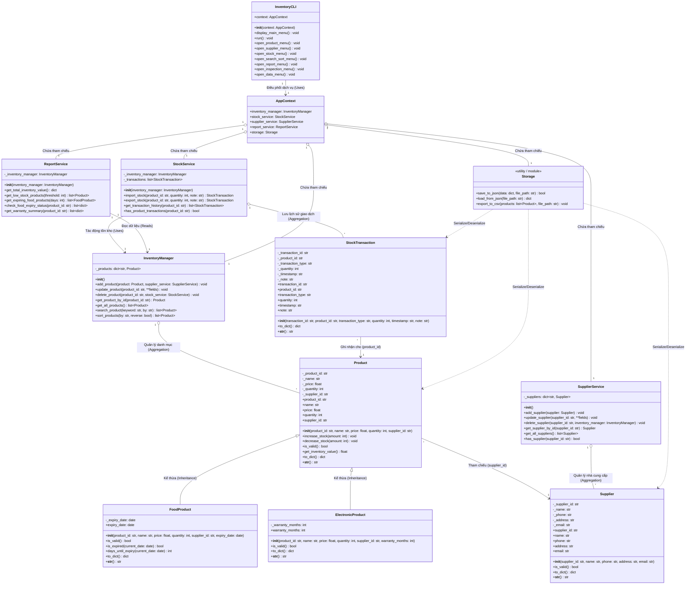
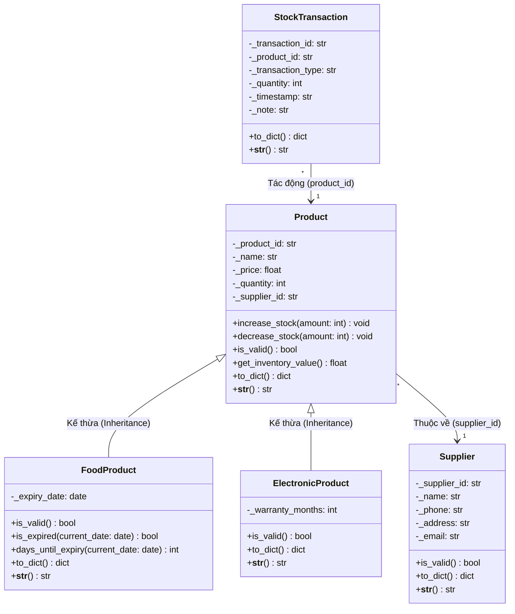
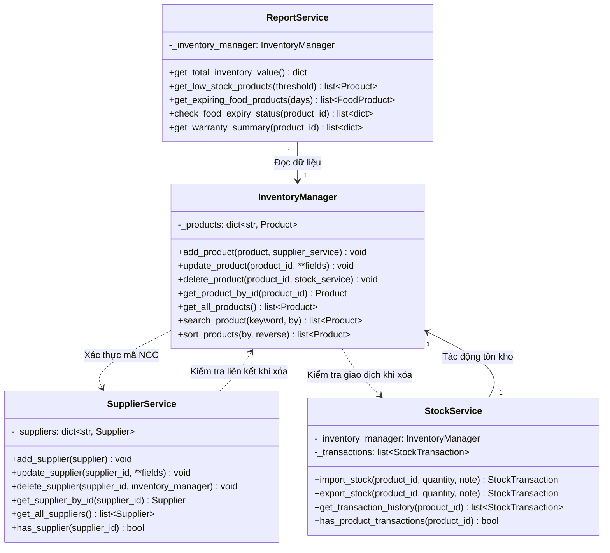

# Thiết Kế UML Sơ Đồ Lớp (Class Diagram) – v1.0

- **Hệ thống:** Product Inventory Management System
- **Chuẩn thiết kế:** Approved Design v1.0 (Khớp 40 quyết định thiết kế chính thức)
- **Tài liệu đối chiếu:** [API_CONTRACT.md](../API_CONTRACT.md), [TASK_ASSIGNMENT.md](../TASK_ASSIGNMENT.md)

---

## 1. SƠ ĐỒ LỚP TỔNG THỂ HỆ THỐNG (SYSTEM OVERVIEW CLASS DIAGRAM)

---

## 2. SƠ ĐỒ LỚP CHI TIẾT TỪNG PHÂN HỆ

Nhằm hỗ trợ chèn vào tài liệu báo cáo Word và slide thuyết trình không bị co nhỏ kích thước, dưới đây là các sơ đồ lớp tách theo tầng nghiệp vụ:

### 2.1. Phân hệ Mô hình Thực thể (Domain Model Layer)
Minh họa tính kế thừa (`Product`, `FoodProduct`, `ElectronicProduct`), liên kết nhà cung cấp và lịch sử giao dịch:

### 2.2. Phân hệ Dịch vụ Nghiệp vụ (Business Logic Services)
Minh họa sự phân tách rõ ràng giữa Quản lý sản phẩm, Nghiệp vụ kho, Quản lý nhà cung cấp và Báo cáo thống kê:

---

## 3. BẢNG MÔ TẢ ĐẶC TẢ CÁC QUAN HỆ TRONG SƠ ĐỒ LỚP

| Quan hệ | Các lớp liên quan | Loại quan hệ | Diễn giải ngữ nghĩa OOP & Nghiệp vụ |
| :--- | :--- | :--- | :--- |
| **Kế thừa (Inheritance)** | `Product` & `FoodProduct` `Product` & `ElectronicProduct` | Generalization (`<|--`) | `FoodProduct` và `ElectronicProduct` là các biến thể chuyên biệt của `Product`, kế thừa toàn bộ thuộc tính cơ sở và ghi đè đa hình các phương thức `is_valid()`, `__str__()`, `to_dict()`. |
| **Tập hợp (Aggregation)** | `InventoryManager` & `Product` | Aggregation (`o--`) | `InventoryManager` sở hữu tập hợp các sản phẩm trong kho (`_products`). Vòng đời của `Product` không hoàn toàn gắn cứng với một phiên `InventoryManager` vì đối tượng có thể được nạp/lưu độc lập qua JSON. |
| **Tập hợp (Aggregation)** | `SupplierService` & `Supplier` | Aggregation (`o--`) | `SupplierService` quản lý tập hợp các đối tượng `Supplier` trong từ điển `_suppliers`. |
| **Tập hợp (Aggregation)** | `StockService` & `StockTransaction` | Aggregation (`o--`) | `StockService` lưu giữ danh sách các đối tượng giao dịch `StockTransaction`. Các bản ghi giao dịch là bất biến (read-only). |
| **Hiệp hội (Association)** | `Product` & `Supplier` | Association (`-->`) | Mỗi `Product` liên kết với đúng 1 `Supplier` thông qua thuộc tính `_supplier_id` (bội số `*` đến `1`). |
| **Hiệp hội (Association)** | `StockService` & `InventoryManager` | Association (`-->`) | `StockService` nhận `InventoryManager` qua constructor (Dependency Injection) để cập nhật tồn kho khi có giao dịch nhập/xuất. |
| **Hiệp hội (Association)** | `ReportService` & `InventoryManager` | Association (`-->`) | `ReportService` nhận `InventoryManager` qua constructor để truy vấn danh sách sản phẩm phục vụ thống kê, không có quyền thay đổi dữ liệu sản phẩm. |
| **Phụ thuộc (Dependency)** | `Storage` & `Product`, `Supplier`, `StockTransaction` | Dependency (`..>`) | `Storage` chịu trách nhiệm serialize các thực thể thành JSON/CSV và deserialize từ JSON thành các thực thể cụ thể. |
| **Phụ thuộc (Dependency)** | `InventoryManager` & `SupplierService` | Dependency (`..>`) | `InventoryManager.add_product` nhận `SupplierService` để kiểm tra sự tồn tại hợp lệ của `supplier_id`. |
| **Phụ thuộc (Dependency)** | `InventoryManager` & `StockService` | Dependency (`..>`) | `InventoryManager.delete_product` nhận `StockService` để kiểm tra sản phẩm chưa từng có lịch sử giao dịch kho trước khi xóa. |
| **Phụ thuộc (Dependency)** | `SupplierService` & `InventoryManager` | Dependency (`..>`) | `SupplierService.delete_supplier` nhận `InventoryManager` để bảo đảm không có sản phẩm nào trong kho đang liên kết với nhà cung cấp cần xóa. |
| **Tập hợp (Aggregation)** | `AppContext` & các `Services` | Aggregation (`o--`) | `AppContext` đóng vai trò Service Container nắm giữ các instance dùng chung của toàn bộ hệ thống. |

---

## 4. QUY TẮC BẢO VỆ TỒN KHO VÀ ĐÓNG GÓI THUỘC TÍNH `QUANTITY`

Nhằm bảo đảm tính toàn vẹn dữ liệu kế toán kho và tuân thủ các quyết định thiết kế (Q08, Q19, Q20, Q23, Q24, Q27), hệ thống áp dụng các quy tắc sau:

1. **`Product.quantity` là thuộc tính chỉ đọc (Read-Only Property):**
   - Biến thể hiện `_quantity` được đóng gói trong lớp `Product` và chỉ công khai qua `@property quantity` (getter).
   - Tuyệt đối không cung cấp setter công khai (`@quantity.setter`) cho thuộc tính này.
2. **`InventoryManager.update_product()` cấm thay đổi số lượng:**
   - Trong quá trình cập nhật sản phẩm (CRUD), `update_product(product_id, **fields)` kiểm tra nếu `fields` có chứa khóa `"quantity"`, hệ thống lập tức ném ngoại lệ `ValueError`. Số lượng tồn kho không được phép chỉnh sửa tùy tiện như các thông tin mô tả.
3. **Chỉ `StockService` điều phối thay đổi tồn kho:**
   - Mọi biến động tăng hoặc giảm tồn kho trong toàn bộ hệ thống bắt buộc phải được điều phối thông qua `StockService.import_stock()` (nhập kho) hoặc `StockService.export_stock()` (xuất kho).
4. **Kiểm tra hợp lệ trong `increase_stock()` và `decrease_stock()`:**
   - Cả hai phương thức `Product.increase_stock(amount: int)` và `Product.decrease_stock(amount: int)` đều thực hiện xác thực đầu vào nghiêm ngặt:
     - `amount` bắt buộc phải là số nguyên dương (`isinstance(amount, int) and not isinstance(amount, bool) and amount > 0`), từ chối giá trị kiểu boolean hoặc số âm/bằng 0.
     - `decrease_stock(amount)` kiểm tra `amount <= self._quantity` nhằm bảo đảm không bao giờ để tồn kho bị âm.
5. **Bản chất đóng gói trong ngôn ngữ Python (Encapsulation Convention vs. Absolute Authorization):**
   - Các phương thức thay đổi `quantity` (`increase_stock`, `decrease_stock`) và việc bảo vệ thuộc tính `_quantity` là cơ chế đóng gói ở mức thiết kế hướng đối tượng và hợp đồng giao diện API (API Contract & Invariant Enforcement).
   - Trong Python, theo triết lý *"we are all consenting adults here"*, ngôn ngữ không hỗ trợ các từ khóa truy cập nghiêm ngặt tuyệt đối như `private` ở mức phần cứng/hệ điều hành. Do đó, các phương thức này **không được xem là cơ chế phân quyền bảo mật tuyệt đối (absolute authorization / access control)**. Tính toàn vẹn của hệ thống dựa vào việc tuân thủ triệt để luồng điều phối của tầng Service và hợp đồng API Contract đã cam kết.

