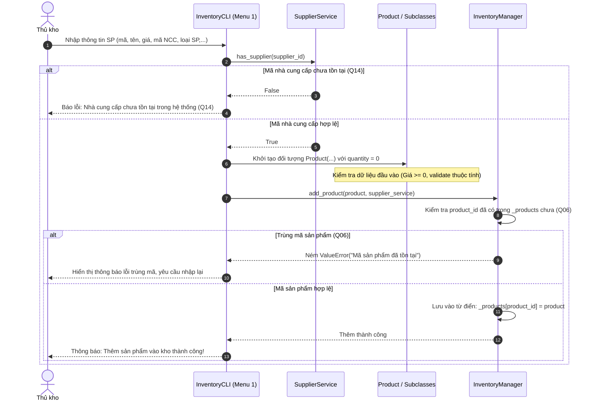
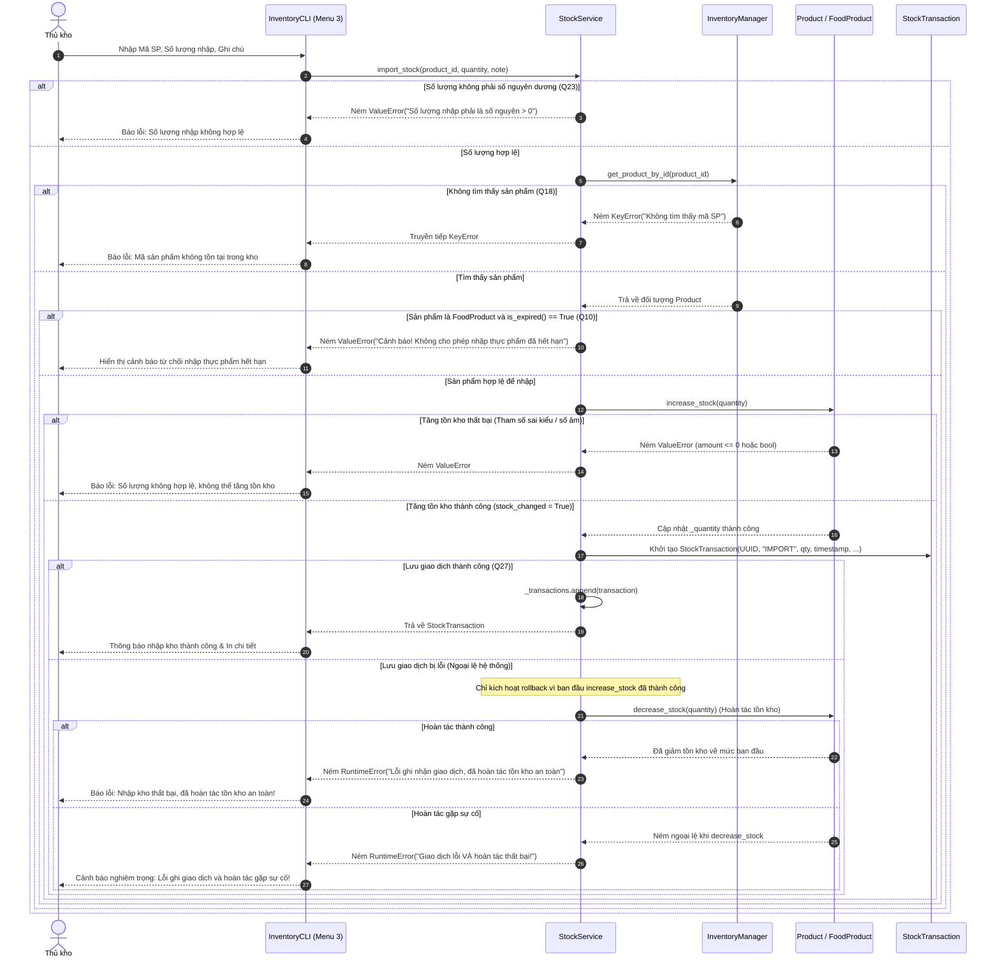
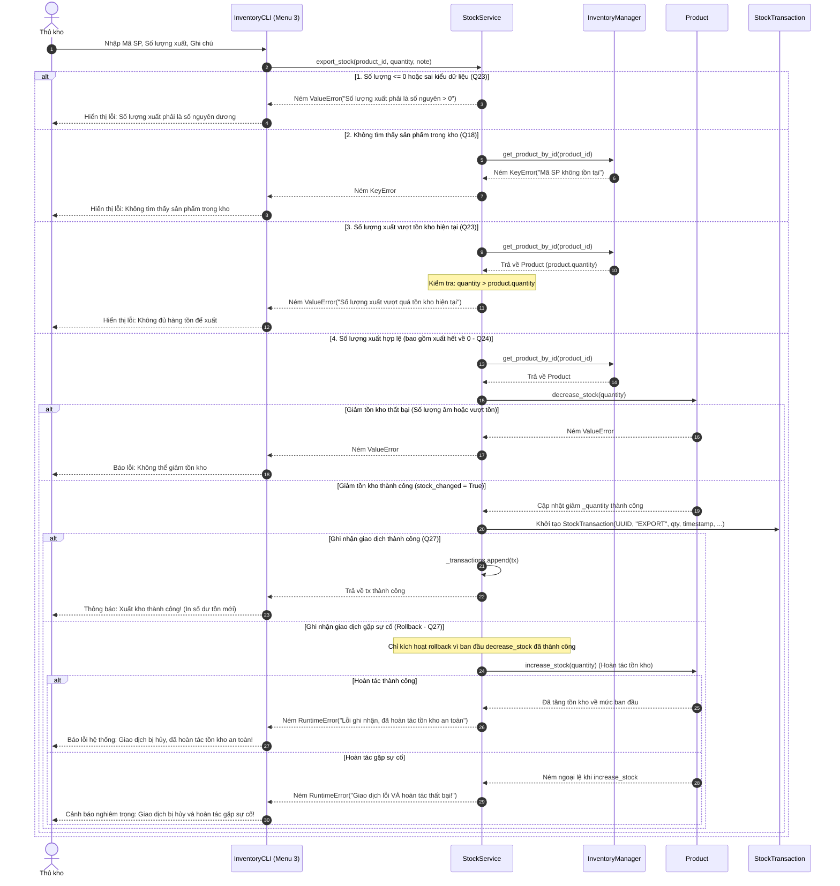
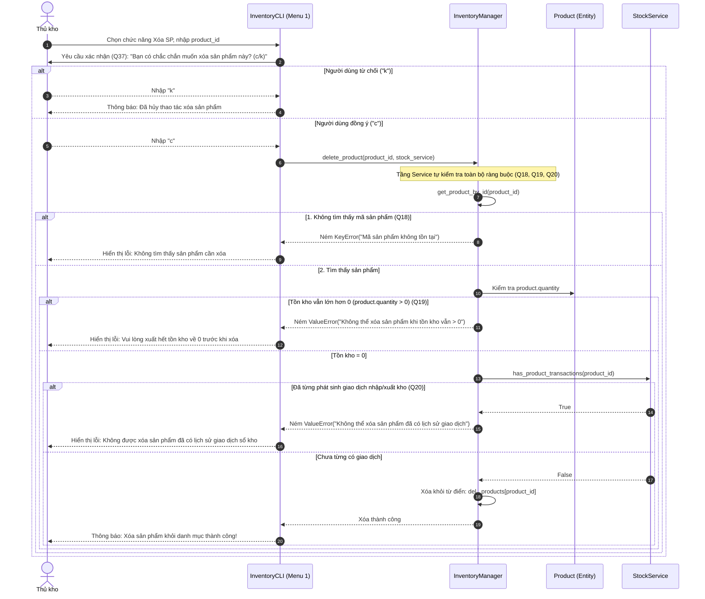
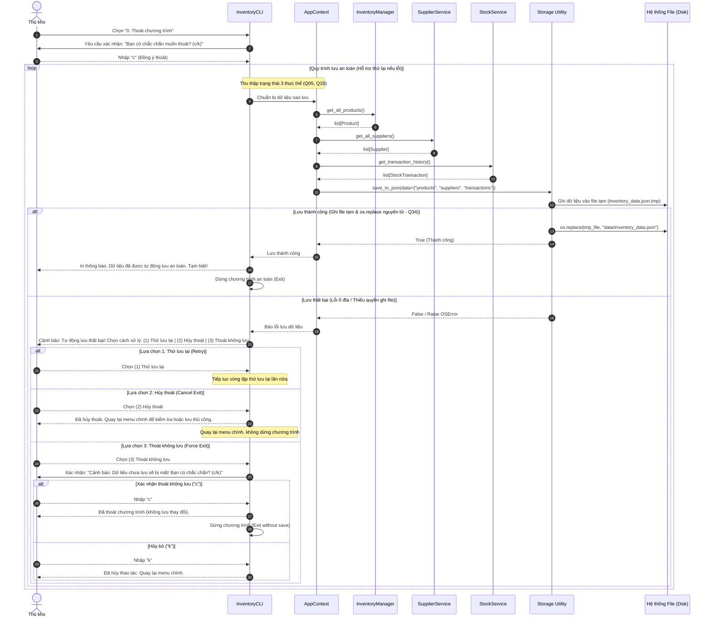

# Thiết Kế UML Sơ Đồ Tuần Tự (Sequence Diagram) – v1.0

- **Hệ thống:** Product Inventory Management System
- **Chuẩn thiết kế:** Approved Design v1.0 (Khớp 40 quyết định thiết kế chính thức)
- **Tài liệu đối chiếu:** [API_CONTRACT.md](../API_CONTRACT.md), [TASK_ASSIGNMENT.md](../TASK_ASSIGNMENT.md)

---

## 1. SƠ ĐỒ TUẦN TỰ: THÊM SẢN PHẨM MỚI (ADD PRODUCT)

Minh họa sự tương tác giữa CLI, `SupplierService`, `Product` entity và `InventoryManager`, kiểm tra mã nhà cung cấp tồn tại (Q14) và chống trùng mã sản phẩm (Q06):

---

## 2. SƠ ĐỒ TUẦN TỰ: NHẬP KHO (IMPORT STOCK)

Minh họa nghiệp vụ nhập kho, kiểm tra số nguyên dương (Q23), `get_product_by_id` ném `KeyError` (Q18), từ chối thực phẩm hết hạn (Q10) và sinh mã UUID (Q25):

---

## 3. SƠ ĐỒ TUẦN TỰ: XUẤT KHO (EXPORT STOCK) VỚI CÁC NHÁNH ALT

Minh họa chi tiết toàn bộ các nhánh rẽ (`alt`) khi xuất kho: lỗi số lượng, `KeyError`, xuất vượt tồn, xuất hết về 0 (Q24) và hoàn tác rollback khi ghi nhận giao dịch thất bại (Q27):

---

## 4. SƠ ĐỒ TUẦN TỰ: XÓA SẢN PHẨM (DELETE PRODUCT)

Minh họa việc kiểm tra ràng buộc xóa hoàn toàn tại tầng Service (`InventoryManager` tự kiểm tra `quantity == 0` và gọi `StockService.has_product_transactions` theo Q19, Q20, không phụ thuộc cờ boolean từ CLI), kết hợp hỏi xác nhận người dùng (Q37):

---

## 5. SƠ ĐỒ TUẦN TỰ: TỰ ĐỘNG LƯU DỮ LIỆU KHI THOÁT ỨNG DỤNG (AUTO-SAVE ON EXIT)

Minh họa luồng thoát ứng dụng, xác nhận người dùng, thu thập trạng thái 3 thực thể (Q33) và ghi file an toàn nguyên tử (Q05, Q34), kèm cơ chế xử lý khi lưu thất bại (cho phép thử lại, hủy thoát, hoặc thoát không lưu):

