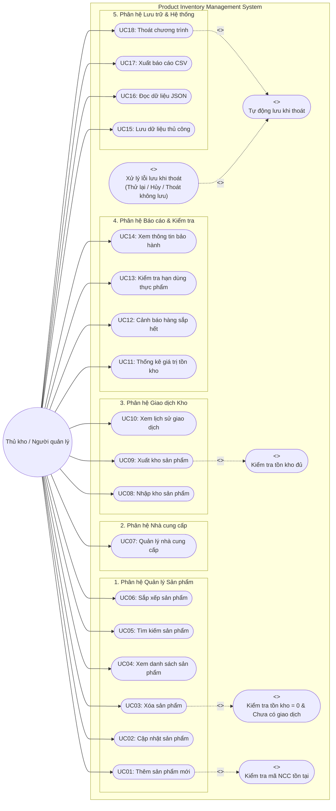
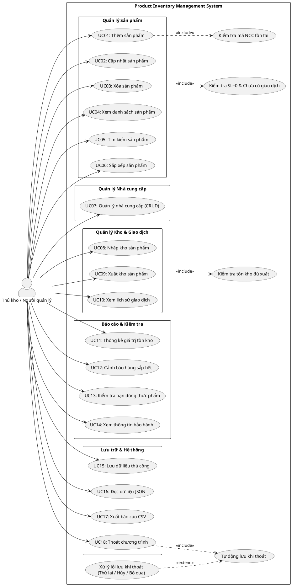

# Thiết Kế UML Sơ Đồ Ca Sử Dụng (Use Case Diagram) – v1.0

- **Hệ thống:** Product Inventory Management System
- **Chuẩn thiết kế:** Approved Design v1.0 (Khớp 40 quyết định thiết kế chính thức)
- **Tài liệu đối chiếu:** [API_CONTRACT.md](../API_CONTRACT.md), [TASK_ASSIGNMENT.md](../TASK_ASSIGNMENT.md)

---

## 1. SƠ ĐỒ USE CASE TỔNG THỂ (MERMAID)

Hệ thống quản lý một kho duy nhất (Q03), không phân quyền và chỉ có **một tác nhân duy nhất** là **Thủ kho / Người quản lý** (Q01, Q02). Hệ thống gồm **18 ca sử dụng chính** được phân bổ vào 5 phân hệ, cùng các ca sử dụng con phục vụ quan hệ `<<include>>` và `<<extend>>`:

---

## 2. NGUỒN PLANTUML CHUẨN ĐỂ XUẤT ẢNH VECTOR (SVG / PNG)

Nhóm có thể copy đoạn mã PlantUML dưới đây vào bất kỳ công cụ PlantUML nào (như [PlantText](https://www.planttext.com/) hoặc extension PlantUML trên VS Code) để xuất file SVG/PNG phục vụ in ấn và chèn vào báo cáo:

---

## 3. BẢNG ĐẶC TẢ CHI TIẾT 18 CA SỬ DỤNG (USE CASE SPECIFICATIONS)

| Mã UC | Tên Ca Sử Dụng | Tiền điều kiện (Preconditions) | Hậu điều kiện (Postconditions) | Luồng chính & Ràng buộc nghiệp vụ theo 40 Quyết định |
| :--- | :--- | :--- | :--- | :--- |
| **UC01** | Thêm sản phẩm mới | Hệ thống đang chạy, đã có nhà cung cấp trong hệ thống. | Sản phẩm mới được lưu vào `InventoryManager` với `quantity = 0`. | Người dùng nhập mã, tên, giá (`>= 0`), loại SP, `supplier_id`. Hệ thống kiểm tra trùng mã (Q06) và kiểm tra `supplier_id` tồn tại (Q14). Nếu là `FoodProduct` nhập ngày hết hạn `YYYY-MM-DD` (Q09), `ElectronicProduct` nhập số tháng bảo hành (Q11). |
| **UC02** | Cập nhật sản phẩm | Sản phẩm cần sửa tồn tại trong hệ thống. | Thông tin sản phẩm được cập nhật an toàn. | Người dùng nhập mã SP cần cập nhật và các trường mới (tên, giá, hạn dùng,...). **Tuyệt đối không cho phép sửa số lượng tồn kho `quantity`** (Q08). |
| **UC03** | Xóa sản phẩm | Sản phẩm cần xóa tồn tại trong hệ thống. | Sản phẩm được xóa khỏi danh mục trong kho. | Hệ thống kiểm tra: **Tồn kho phải bằng 0 (`quantity == 0`)** (Q19) và **chưa từng có bất kỳ giao dịch nhập/xuất nào** (Q20). Ràng buộc kiểm tra trực tiếp ở tầng service. CLI hiển thị xác nhận `c/k` trước khi xóa (Q37). |
| **UC04** | Xem danh sách sản phẩm | Không có. | Danh sách sản phẩm được in ra màn hình Console. | Hiển thị dạng bảng gồm mã, tên, loại, giá, số lượng tồn, giá trị tồn và nhà cung cấp. Nếu kho rỗng thông báo danh sách rỗng (không crash). |
| **UC05** | Tìm kiếm sản phẩm | Không có. | Danh sách sản phẩm thỏa mãn tiêu chí tìm kiếm. | Cho phép tìm kiếm theo mã, tên hoặc nhà cung cấp. Tìm kiếm theo tên không phân biệt hoa/thường nhưng giữ nguyên dấu tiếng Việt (Q21). |
| **UC06** | Sắp xếp sản phẩm | Kho có ít nhất 1 sản phẩm. | Danh sách sản phẩm được sắp xếp theo yêu cầu. | Cho phép chọn tiêu chí sắp xếp: theo giá hoặc theo số lượng; chọn thứ tự tăng dần hoặc giảm dần (Q22). Không làm thay đổi trật tự gốc trong từ điển kho. |
| **UC07** | Quản lý nhà cung cấp | Không có. | Nhà cung cấp được thêm/sửa/xóa/hiển thị qua `SupplierService`. | Hỗ trợ CRUD nhà cung cấp riêng biệt (Q16). Chống trùng mã NCC. **Cấm xóa nhà cung cấp nếu vẫn còn sản phẩm trong kho đang tham chiếu tới** (Q15). CLI yêu cầu xác nhận `c/k` khi xóa (Q37). |
| **UC08** | Nhập kho sản phẩm | Sản phẩm đã được tạo trong danh mục. | Tồn kho tăng thêm số lượng nhập, 1 giao dịch IMPORT được lưu. | Người dùng nhập mã SP, số lượng nhập (số nguyên dương, từ chối bool theo Q23). Nếu là thực phẩm, **từ chối nhập nếu thực phẩm đã hết hạn** (Q10). Điều phối qua `Product.increase_stock(quantity)`. Mã giao dịch sinh tự động qua UUID (Q25). Hoàn tác an toàn qua `decrease_stock(quantity)` nếu lỗi (Q27). |
| **UC09** | Xuất kho sản phẩm | Sản phẩm tồn tại, số lượng tồn kho `quantity > 0`. | Tồn kho giảm tương ứng, 1 giao dịch EXPORT được lưu. | Người dùng nhập mã SP, số lượng xuất (nguyên dương theo Q23). Kiểm tra `quantity <= product.quantity`. Cho phép xuất hết toàn bộ tồn kho về 0 (Q24). Từ chối nếu xuất vượt tồn. Điều phối qua `Product.decrease_stock(quantity)`. Sinh mã UUID (Q25), hoàn tác an toàn qua `increase_stock(quantity)` nếu lỗi (Q27). |
| **UC10** | Xem lịch sử giao dịch | Không có. | Toàn bộ hoặc lịch sử lọc theo mã SP được hiển thị. | Hiển thị danh sách giao dịch gồm mã giao dịch, thời gian (ISO có múi giờ), mã SP, loại (IMPORT/EXPORT), số lượng, ghi chú (Q26). Lịch sử chỉ đọc, không sửa/xóa (Q28). |
| **UC11** | Thống kê giá trị tồn kho | Không có. | Hiển thị tổng giá trị hàng tồn toàn kho. | Tính tổng `price * quantity` của tất cả sản phẩm. Nếu có thực phẩm đã hết hạn, hệ thống hiển thị cảnh báo giá trị tồn kho có nguy cơ rủi ro riêng (Q32). |
| **UC12** | Cảnh báo hàng sắp hết | Không có. | Danh sách các sản phẩm có tồn kho dưới ngưỡng. | Người dùng có thể dùng ngưỡng mặc định là 5 hoặc nhập ngưỡng tùy chọn (Q29). Lọc các sản phẩm có `0 <= quantity <= threshold`. |
| **UC13** | Kiểm tra hạn dùng thực phẩm | Có thực phẩm trong kho. | Báo cáo chi tiết tình trạng hạn sử dụng. | Phân loại rõ ràng 3 nhóm: thực phẩm đã hết hạn, thực phẩm cận hạn (mặc định trong vòng 7 ngày theo Q30), và thực phẩm còn hạn an toàn (Q31). |
| **UC14** | Xem thông tin bảo hành | Có thiết bị điện tử trong kho. | Danh sách thiết bị điện tử kèm thời hạn bảo hành. | Thống kê danh sách thiết bị điện tử và thời hạn bảo hành danh nghĩa theo tháng (`warranty_months`), không tự ý suy đoán ngày hết hạn bảo hành cố định (Q11). |
| **UC15** | Lưu dữ liệu thủ công | Có dữ liệu trong bộ nhớ hệ thống. | Toàn bộ 3 thực thể (`products`, `suppliers`, `transactions`) được lưu ra file JSON an toàn. | Người dùng chủ động chọn lưu dữ liệu từ Menu Quản lý Dữ liệu (Menu 7). Hệ thống ghi file nguyên tử (atomic replace) qua file tạm (Q33, Q34) để chống hỏng file nếu xảy ra mất điện/crash. |
| **UC16** | Đọc dữ liệu JSON | File JSON dữ liệu tồn tại trên đĩa. | Toàn bộ dữ liệu từ JSON được nạp vào bộ nhớ hệ thống. | Người dùng chủ động chọn nạp lại dữ liệu từ Menu 7. Nếu cấu trúc JSON bị hỏng hoặc dữ liệu thiếu hợp lệ, hệ thống hủy thao tác và bảo toàn nguyên trạng dữ liệu hiện hành trong bộ nhớ (Q34). |
| **UC17** | Xuất báo cáo CSV | Có dữ liệu sản phẩm trong kho. | File `inventory_report.csv` được tạo ra. | Xuất đầy đủ 7 cột: `product_id`, `name`, `product_type`, `price`, `quantity`, `inventory_value`, `supplier` với encoding `utf-8-sig` tương thích mở trên Excel (Q35). |
| **UC18** | Thoát chương trình | Ứng dụng đang chạy ở menu chính. | Chương trình kết thúc an toàn. Nếu lưu thành công, toàn bộ dữ liệu phiên làm việc được bảo toàn trong JSON; nếu người dùng xác nhận thoát không lưu sau khi lưu thất bại thì chương trình kết thúc nhưng dữ liệu chưa lưu có thể bị mất. | Người dùng chọn chức năng `0. Thoát chương trình`. Hệ thống bắt buộc thực thi ca sử dụng bao hàm `<<include>>`: **Tự động lưu khi thoát** thông qua hàm chuẩn `save_to_json(data, file_path)`. Nếu lưu thất bại, kích hoạt ca sử dụng mở rộng `<<extend>>` cho phép người dùng chọn: Thử lưu lại, Hủy thoát (quay lại ứng dụng) hoặc Thoát không lưu. |

